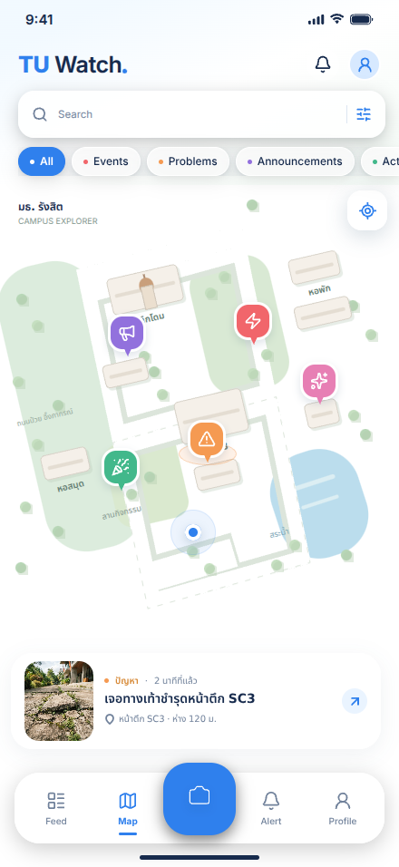
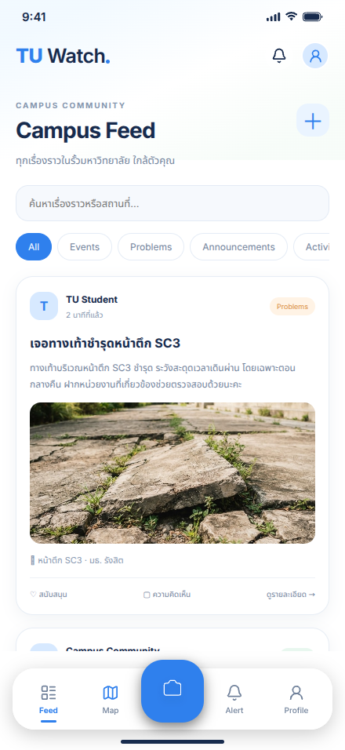
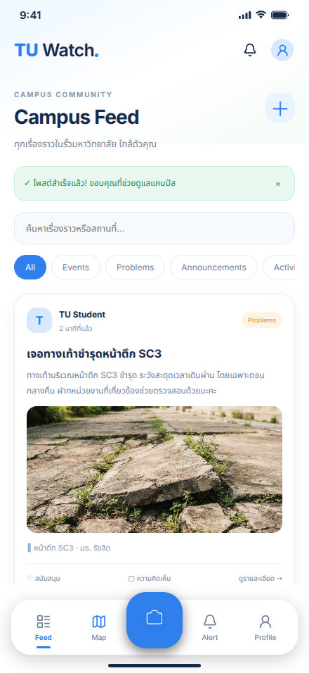
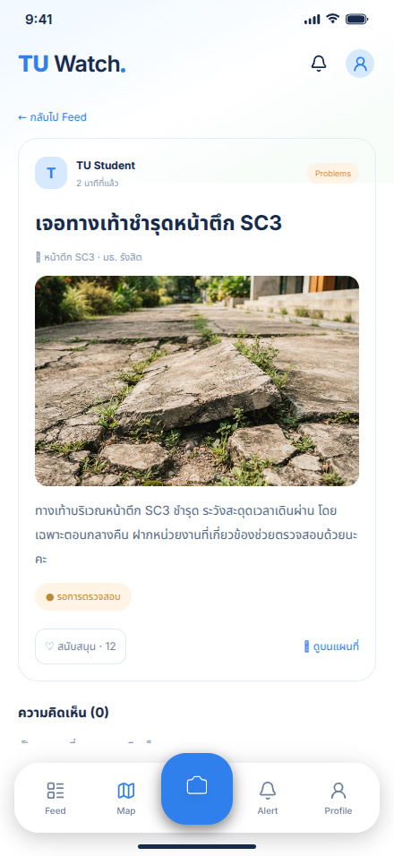
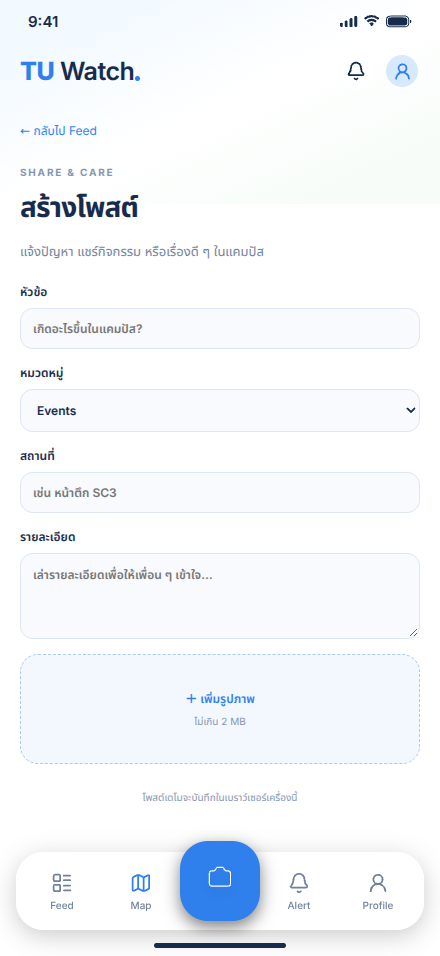
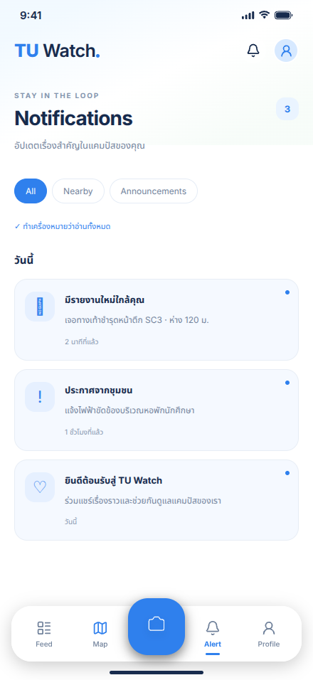
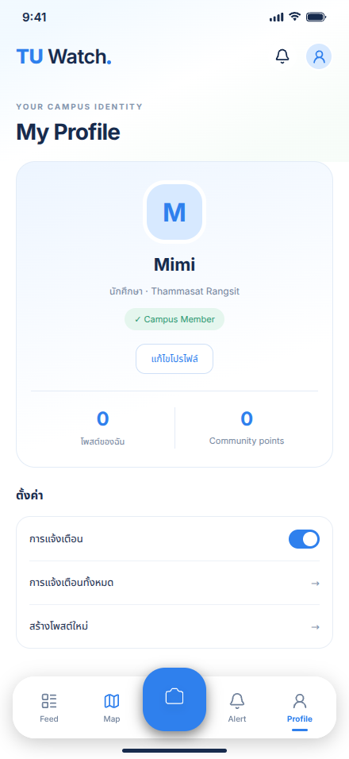

# TU Watch
### Your campus. Connected.

A mobile-focused campus community web prototype for **Thammasat University, Rangsit campus**. TU Watch brings campus reports, activities, and announcements into a connected map and community feed.

> **Prototype status:** The app uses an illustrated campus map, sample community posts, and browser-local storage. It does not yet include authentication, a shared backend, live maps, or real push notifications.

## Why TU Watch?

Useful campus updates can get lost across group chats and social media. TU Watch explores a simpler way for students to discover nearby issues, share updates, and contribute to their campus community.

## Features

| Screen | Current functionality |
| --- | --- |
| Campus Map | Illustrated campus layout, report markers linking to post details, and a highlighted sidewalk report |
| Campus Feed | Browse posts, search by text, and filter by category |
| Create a Post | Submit a title, category, location, description, and optional image |
| Submission feedback | Success message in the feed after creating a post |
| Post Details | Read reports, support a post, and add comments |
| Notifications | View sample alerts, filter them, and mark them read for the current page session |
| Profile | Edit a local display name, toggle a local notification preference, and browse locally created posts |

Posts and comments persist in the same browser through `localStorage`. Support counts are demonstration state and reset when the detail page is reloaded. Profile settings are local preferences; the prototype has no user accounts.

## Screenshots

Screenshots captured from the running web prototype at a 440 × 956 viewport. Local copies of the intended fonts were loaded for capture. These show the implemented screens, rather than generated concept artwork.

| Campus Map | Campus Feed |
| --- | --- |
|  |  |

| Post Submitted | Post Details |
| --- | --- |
|  |  |

| Create a Post | Notifications |
| --- | --- |
|  |  |

| Profile |
| --- |
|  |

Scrollable screens may include additional content below the visible area.

## Tech Stack

- **Next.js 15** — application routing and rendering
- **React 19** — UI components and client-side state
- **TypeScript** — type checking
- **CSS** — layouts and styling
- **Figma** — interface design
- **GitHub** — source control

## Run Locally

Install a current Node.js LTS release compatible with Next.js 15 and npm.

```bash
git clone https://github.com/mimiplly/tuwatch.git
cd tuwatch
npm ci
npm run dev
```

Open [http://localhost:3000](http://localhost:3000).

The current prototype requires **no API keys or environment variables**. Google Fonts are loaded through CSS; system fonts serve as fallbacks when unavailable.

If you already have the repository:

```bash
git pull origin main
npm ci
npm run dev
```

## Try the Core Flow

1. Open **Feed** using the bottom navigation.
2. Tap the central **＋** button to create a post.
3. Enter a title, location, and description; choose a category.
4. Optionally attach an image up to **2 MB**.
5. Submit the post and check the success message in the feed.
6. Open the new post and add a comment.
7. Reload to see locally saved posts and comments.

Images are stored with posts in browser storage. A large image or full storage quota can prevent saving; try a smaller image or submit without one.

## Routes

| Route | Screen |
| --- | --- |
| `/` | Campus Map |
| `/feed` | Community Feed |
| `/feed?submitted=1` | Feed with submission confirmation |
| `/report` | Create a Post |
| `/posts/[id]` | Post Details |
| `/alerts` | Notifications |
| `/profile` | Profile |

## Project Structure

```text
app/
  page.tsx                 Campus map entry
  feed/page.tsx            Community feed
  report/page.tsx          Reporting form
  posts/[id]/page.tsx      Dynamic post details
  alerts/page.tsx          Notifications
  profile/page.tsx         Profile
  layout.tsx               Root layout and metadata
  globals.css              Shared styles
components/
  AppShell.tsx             Shared mobile page layout
  Community.tsx            Community screens and local demo data
  home/                    Header, search, categories, incident card
  map/                     Illustrated map and report markers
  navigation/              Bottom navigation
public/assets/tuwatch/     Local visual assets
```

## Validation

```bash
npm run typecheck
npm run build
npm run start
```

The implementation passed a production build, including TypeScript validation. Local HTTP checks returned **200** for all six main routes and selected visual assets. Browser checks also passed for creating a post, opening its details, adding a comment, and retaining the comment after reload, with no JavaScript page errors observed. Screenshots were captured for all seven screen states. Full interaction coverage and visual comparison against Figma have not yet been completed.

## Current Limitations

- Data is stored only in the current browser and is not shared between users or devices.
- The map is an illustration, not a live mapping service.
- Map search and location controls are visual placeholders.
- Category chips on the map change selection styling; they do not filter map markers.
- Notifications are sample data. The profile toggle does not enable push notifications.
- The app has no authentication, server database, moderation, or official campus reporting integration.
- The mobile layout scales from a fixed 440 × 956 canvas.
- Newly added screens follow the existing project style; exact Figma fidelity has not been verified.

Avoid entering sensitive information into this demo. Clearing site storage removes locally saved posts, comments, and preferences.

## Future Development

- Authentication and a shared database
- Live map integration and report coordinates
- Persistent support counts and real notifications
- Moderation, report verification, and status tracking
- Accessibility improvements and broader responsive layouts
- Visual refinement against the Figma designs

## Design

[View the Figma design](https://www.figma.com/design/p6WqPalrB9HdnsRLJR9lw8/Untitled)

This is a student prototype and is not presented as an official university reporting service.
